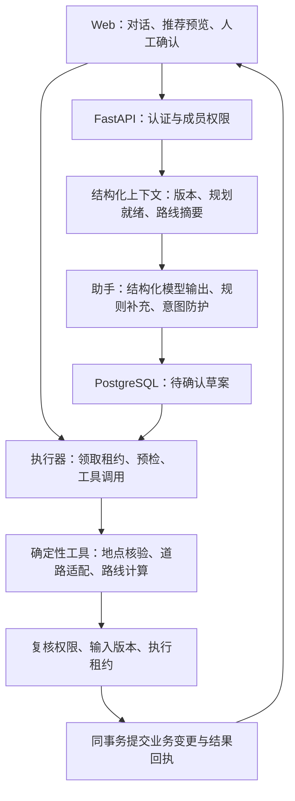

# Agent 应用工程说明与演示

项目定位：多人出行场景下的受控Agent应用。支持餐饮发现、品牌分店比较和区域半日游，并将推荐衔接收藏、协作地点、正式路线及完成评价。当前是本机可运行的工程作品，尚未部署为生产服务。当前简历定位、证据和下一阶段退出条件见[PROJECT_READINESS.md](PROJECT_READINESS.md)。

## 架构与职责

三个推荐场景共用工具和编排代码，并非三个自主协商的独立Agent。助手采用JSON action协议和自定义执行器，当前没有使用LangChain/LangGraph、向量数据库、RAG或无限自主循环。

| 工程职责 | 实际实现 | 可检查的证据 |
|---|---|---|
| 结构化输出与意图 | app/services/agent_assistant.py | Pydantic动作白名单、参数校验、否定/解释防护与规则降级 |
| 推荐事实与路线 | place_discovery.py、amap.py、itinerary.py | POI/道路工具、真实与估算区分、有界排序与时间警告 |
| 请求级观测 | agent_trace.py、tests/test_agent_trace.py | ContextVar隔离、嵌套span、本人读取、24小时TTL及容量上限 |
| 受控执行 | app/routers/agent.py | 草案和执行分离、创建者权限、输入版本、预检和事务 |
| 并发与恢复 | app/services/agent_state.py | 原子领取、2分钟可续租、租约令牌复核、结果回执重放 |
| 数据生命周期 | agent_state.py及独立清理脚本 | 草案10分钟有效、原文最小化与故障恢复测试 |
| 评测与CI | scripts/evaluate_agent.py、evals、tests | 样例级检查、失败退出、报告指纹、离线CI门禁 |
| 现有观测 | llm_parser.py、amap.py、diagnostics路由 | 进程内usage、缓存命中与服务调用统计，不含提示词原文 |

模型负责理解和提出草案，不负责提供道路事实、认定权限或直接写数据库。草案展示给用户后，执行器重新核对归属、权限、Trip状态、input_version和领取租约；模型输出通过schema也不能越过这些检查。

执行中取得脱离ORM的输入并在事务外计算，再在最终事务核对版本和租约。正式变更、路线快照和消费回执共同提交；同一草案重放读取原回执。执行进程消失后租约可恢复，旧执行者不能凭过期令牌提交。这是有条件的幂等业务提交，不宣称外部API严格只调用一次或所有场景天然exactly-once。

## 可复现的证据

1. 按README启动本机Web与PostgreSQL，迁移至head。
2. 运行离线评测：

       python scripts/evaluate_agent.py

3. 执行数据库、HTTP和子进程恢复回归：

       $env:AGENT_DB_TESTS = '1'
       python -m unittest discover -s tests -q

4. 演示优先使用 `python scripts/run_demo.py` 的固定隔离环境；浏览器验收仍可使用scripts/BROWSER_ACCEPTANCE.md随机schema服务。不把随机密码、state文件、真实.env或用户数据上传作品集；停止后核对cleaned。

公开评测集和报告见[evals说明](evals/README.md)。真实模型评测使用公开合成输入并限制样例数，本机和真实服务结果分开记录。

## 面试演示顺序（约8分钟）

- 1分钟：讲清“多人不同起点＋喜好＋时间”的任务，展示职责图。
- 2分钟：展示三场景推荐、收藏标签和理由，说明哪些事实由工具提供、哪些信息未知。
- 2分钟：展示时间冲突，修改停留后重算，对比前后方案；解释版本变化为什么让旧草案失效。
- 2分钟：运行31条离线评测，讲一个否定指令失败案例如何被发现、修复和加入CI。
- 1分钟：打开执行器及隔离恢复测试，解释重复点击、执行崩溃和旧工作者恢复时的处理。

可直接运行 `python scripts/run_demo.py` 使用固定隔离演示数据，完整操作见[scripts/LOCAL_DEMO.md](scripts/LOCAL_DEMO.md)。

需要新密码或恢复码的演示由操作者自行输入，不在录屏中展示秘密。无法现场运行的能力，用对应测试和保存证据说明，不模拟成功结果。

## 可以写进简历的事实

- 基于FastAPI、PostgreSQL和原生Web实现多人出行Agent应用，支持三类地点推荐任务；采用结构化action、人工确认和确定性地图/路线工具衔接正式行程。
- 实现带input_version校验、执行租约、原子提交与结果回执的草案执行流程，通过隔离数据库及真实进程中断测试验证重放、回滚和恢复边界。
- 建立三场景12组24轮任务评测，使用真实隔离数据库与固定工具夹具验证条件修正、收藏筛选、工具失败估算和预览无业务写入，并接入CI门禁。
- 建立31条公开合成Agent评测，定位并修复6个指令识别/输入处理问题，在同一离线集合上将通过数由25提升至31、意外动作由3降至0、异常由2降至0，并接入CI门禁。

这些描述对应代码和实际测试，不能扩展成线上用户量、生产可用性、真实推荐准确率或大型分布式Agent的经历。框架或云服务仅在确实采用并验证后加入技能描述。

## 后续工程路线

已增加请求级观测，接口与边界见 [AGENT_OBSERVABILITY.md](AGENT_OBSERVABILITY.md)：聊天和执行返回trace_id，串联上下文、模型、地图、路线估算、执行准备和事务提交；支持阶段耗时、实际token、错误类型、规则降级和幂等重放识别。采用有界进程内存储，只有请求本人且仍是行程成员可读取；重启丢失，多worker不汇总，尚未接入OpenTelemetry或外部观测平台。

已增加[三场景任务级评测](evals/DISCOVERY_TASKS.md)：12组24轮，真实隔离PostgreSQL、固定工具数据，验证条件补全、偏好/标签/时间修改、同名地点消歧和工具不可用后恢复。首次完整评分12/12组、24/24轮通过；没有真实模型或地图调用，多轮由结构化条件保留实现，不证明自然语言记忆或线上推荐质量。仍需独立人工盲测任务与少量真实模型/工具对照，不能用公开回归集证明泛化。

已加入[一键本机演示](scripts/LOCAL_DEMO.md)：独立进程/随机schema、真实登录和业务API、固定4个行程、外部服务禁用、随机短期凭据、正常停止或TTL自动清理。真实子进程HTTP自检覆盖三场景、执行重放/追踪、估算确认、冲突修正与重置。尚未录制浏览器演示视频或取得云端CI运行证据；当前按用户要求保持本机开发，部署相关HTTPS、监控、备份和跨进程广播留待部署阶段。
